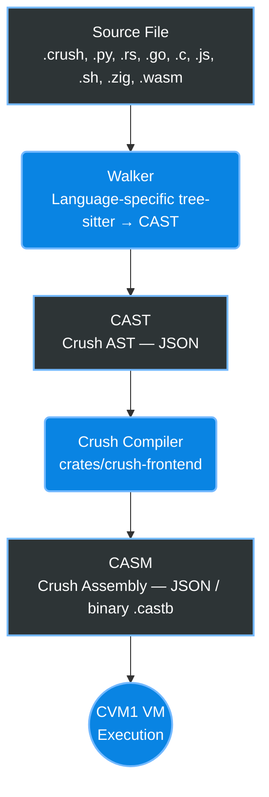

<p align="center">
  
</p>

<h1 align="center">
  
  Crush AST
</h1>

<p align="center">
  <strong>Polyglot Intermediate Representation & Toolchain</strong>
</p>

<p align="center">
  <a href="LICENSE-MIT"></a>
  
</p>

<p align="center">
  <a href="https://crushlang.org">crushlang.org</a> ·
  <a href="https://docs.crushlang.org">Language Guide</a>
</p>

---

**Crush** is a capability-based, polyglot programming language and virtual runtime. This repository hosts the **standalone Crush implementation**: providing the CAST intermediate representation, tree-sitter grammar, polyglot walkers, compiler frontend, VM runtime, package manager, and installer.

👉 **[crushlang.org](https://crushlang.org)** for the landing page and a live example, or **[docs.crushlang.org](https://docs.crushlang.org)** for the full language guide (syntax, capability system, polyglot programming, stdlib, CAST/CASM, worked examples).

## 🌌 Relationship to Exosphere

This repository was extracted from the [exosphere](https://github.com/nixpt/exosphere) agent-native OS monorepo on 2026-06-12. The walker crate tree (the polyglot source → CAST translators) was split out so it could compile independently without pulling in the full exosphere kernel runtime. Exosphere retains a subprocess-based `WalkerRegistry` that invokes the walker binaries produced here.

The repos are **peer projects** — no path dependencies run in either direction. Exosphere pins its own `crush-cast`/`casm` at v1.0.0; crush-ast's own crates are released together (the workspace version, `0.6.0` on crates.io as of 2026-10-15).

## 🏗️ Repository Structure

```text
crates/
├── crush-errors/         # Unified error types (leaf crate)
├── crush-cast/           # CAST — Crush Abstract Syntax Tree IR
├── crush-cosm/           # COSM — Crush Object Semantic Model: Kind declarations, C3, validation (structs/impl/trait/@kind)
├── crush-caison/         # CAISON (formerly CSON) format + `caison.parse` VM capability
├── crush-cson-shim/      # retired `crush-cson` name: re-exports crush-caison
├── casm/                 # CASM — Crush Assembly bytecode format
├── tree-sitter-crush/    # Tree-sitter grammar for the Crush language
├── crush-diagnostics/    # Shared diagnostics/wire-format types
├── crush-index/          # Cross-crate symbol/reference index
│
├── crush-walker-core/    # LanguageAdapter trait + shared walker utilities (renamed from walker-core)
├── cli/                  # crush-walker — CLI that auto-detects source language and dispatches a walker
├── crush-lang-python/    # Python → CAST (bin: python_walker)
├── crush-lang-rust/      # Rust → CAST (syn-based; refuses what it can't prove exact)
├── crush-lang-js/        # JavaScript → CAST
├── crush-lang-go/        # Go → CAST
├── crush-lang-c/         # C → CAST
├── crush-lang-zig/       # Zig → CAST
├── crush-lang-bash/      # Bash → CAST
├── crush-lang-zsh/       # Zsh → CAST
├── crush-lang-wasm/      # WebAssembly walker — parses Wasm modules into CAST IR
├── crush-lang-dart/      # Dart → CAST
├── crush-lang-nepali/    # Nepali (Sona) → CAST
├── crush-lang-java/      # Java → CAST (skeleton)
├── crush-lang-custom/    # Custom/user-defined language adapter scaffold
│
├── crush-frontend/       # Crush language parser, semantic analyzer, optimizer, and CASM compiler
├── crush-lang-sdk/       # Rust SDK for hosting the CVM1 runtime (produces: crushc, crush-run, crush-compile, crush-repl)
├── crush-vm/             # CVM1 bytecode assembler, disassembler, and sandboxed interpreter (incl. polyglot exec + capability gates)
├── crush-vm-capi/        # C API shared library for embedding CrushVM in C/C++ programs
├── crush-vm-py/          # Python extension module (PyO3) exposing the canonical CVM1 VM
├── crush-jit/            # Cranelift-based JIT backend (native execution tier)
├── crush-aot/            # AOT: CASM → Rust (rustc) or C (gcc/clang) → native .so (bins: crush-aotc, crush-walk-run)
├── crush-aotc/           # Typed AOT compiler library: CASM → C source → shared library (.so)
├── crush-ptx/            # CASM → PTX (NVIDIA GPU assembly) emission backend
├── crush-web/            # Browser WebAssembly runtime (compiles/runs CAST via crush-frontend + crush-vm's portable interpreter)
├── crush-ffi/            # C-ABI plugin interface
├── crush-plugin-example/ # Example native plugin built on crush-ffi
├── crush-python/         # PyO3 bindings exposing crush-cast to Python
├── crush-debugger/       # Debugger hooks over crush-vm
├── crush-lint/           # Static lint pass over CAST/CASM
├── crush-macros/         # Proc-macros shared across the workspace
├── crush-net/            # Mesh/network-facing bindings (crush-lang-sdk over mesh-proto)
├── crush-tui/            # Terminal UI front-end
├── crush-pkg/            # Package manager — cargo-like build tool for Crush (uses buckets for sandboxed script runtimes)
└── crush-installer/      # Toolchain installer and uninstaller
```

`crates/crush-bucketspike/` also exists but is deliberately excluded from this list — it's an internal throwaway spike (see its own `Cargo.toml` description), not part of the release surface.

## 🚀 Quick Start

### Building from Source

You need a current stable Rust (`rust-toolchain.toml` selects `stable`). `crush-pkg` and `crush-vm` path-depend on
[`nixpt/buckets`](https://github.com/nixpt/buckets), so clone it next to this
repo first (CI does the same):

```bash
git clone https://github.com/nixpt/buckets ../buckets
```

```bash
# Build the core SDK and package manager
cargo build -p crush-lang-sdk -p crush-pkg

# Install to ~/.crush using the included installer
cargo run --bin crush-installer -- install --bin-dir target/debug
```

### Running Directly

```bash
# Check compiler options
cargo run --bin crushc -- --help

# Run a Crush script directly
cargo run --bin crush-run -- run my-program.crush
```

A first program, with what it prints (verified against `3ae0b4a`):

```crush
fn make_counter() {
    let c = 0
    return || {
        c = c + 1
        return c
    }
}
let next = make_counter()
next()
print(next())
```

```text
2
```

Capabilities are opt-in per run. The standard library (`str.*`, `math.*`,
`json.*`, …) is on by default; everything that touches the host needs a flag
(`--fs`, `--net`, `--env`, `--time`, `--process`, `--polyglot`, …), and a program
that needs an ungranted capability is refused before it runs.
`crush-run caps FILE` shows what a program needs without running it.

## ⚙️ Compilation Pipeline

The Crush pipeline seamlessly converts polyglot source code down to execution-ready bytecode through an interconnected set of stages.



## 🎮 Examples

[`examples/crush/`](examples/crush/) holds 50+ `.crush` programs, from language-feature smoke
tests (`arithmetic.crush`, `control_flow.crush`, `exception_test.crush`, ...) to full self-playing
programs written by several different LLMs given the same "learn this language" prompt — two
hosted-language interpreters (`forth.crush`, `brainfuck.crush`), self-playing games
(`tictactoe.crush`, `lights_out.crush`, `pong.crush`, `breakout.crush`), an IDA*-based 15-puzzle
solver (`fifteen_puzzle.crush`), and Conway's Game of Life. The story behind that particular set —
which model wrote what, and the real language constraints/bugs each one hit — is documented in
[`nixpt/awesome-crush`](https://github.com/nixpt/awesome-crush).

## 📚 Documentation

- [The Crush Language Guide](https://github.com/nixpt/crush-language-guide) ([docs.crushlang.org](https://docs.crushlang.org)) — language reference, examples, CAST/CASM specifications. Every example in it is run against a pinned crush-ast commit, and its `examples/verified/` corpus keeps one small program per language behaviour with its exact output.
- Comprehensive crate-level documentation is available in the respective `crates/*/README.md` files.

## ⚖️ License

Licensed under either of [MIT](LICENSE-MIT) or [Apache License 2.0](LICENSE-APACHE) at your option.

Unless you explicitly state otherwise, any contribution intentionally submitted for inclusion in this work shall be dual-licensed as above, without any additional terms or conditions.
